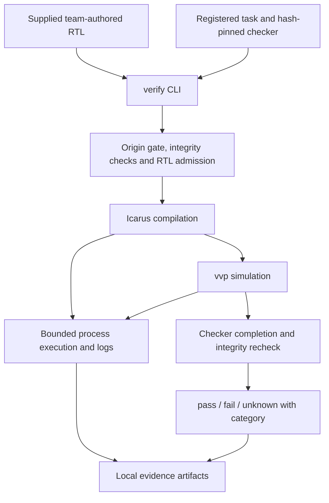

# An LLM Copilot for Verilog Design

**Rutgers ECE Capstone · Group 62 · Academic Year 2026–2027**

| Project information | Details |
| --- | --- |
| Team | Four undergraduate Electrical and Computer Engineering students |
| Faculty advisor | Professor Hang Liu |
| Repository | [YCW701/llm-verilog-copilot](https://github.com/YCW701/llm-verilog-copilot) |
| Published M1 baseline | [`m1-baseline`](https://github.com/YCW701/llm-verilog-copilot/tree/m1-baseline), commit [`e2e1066`](https://github.com/YCW701/llm-verilog-copilot/commit/e2e1066cebad8c12516818f813c08a71897f5d8e) |
| Current application | **M1: offline Icarus verification harness** |
| Next work | M2 is proposed; runtime LLM generation and repair are not implemented |

## Project overview

This capstone investigates whether simulation feedback can improve the reliability of LLM-generated Verilog. The intended system converts natural-language hardware specifications into RTL, compiles and simulates each candidate, and uses compiler errors and testbench feedback for bounded repair. Planned evaluation compares one-shot generation with simulation-guided repair on VerilogEval or RTLLM, including pass@1, pass@k, and post-synthesis area/timing. FPGA implementation is optional.

The selected scope is Idea 3, “An LLM copilot for Verilog design,” in Professor Hang Liu's *Four LLM Capstone Projects* presentation, Slide 5, as supplied by the team. **The current application is the verification foundation, not the complete copilot.** It accepts a supplied, team-authored RTL file; it does not accept natural-language specifications, call an LLM, generate RTL, or repair a design.

## System architecture

### Implemented M1 path



The diagram shows the successful path; failed prerequisites stop subsequent stages. The verifier also records bounded tool-version probes before compilation. A compiler exit code of zero or a candidate's printed `PASS` message cannot establish correctness.

- `cli.py`, `models.py`, and `storage.py` handle validated commands, structured records, hashes, and collision-refusing artifacts.
- `rtl.py` screens the exact candidate copy for the restricted supported subset.
- `tools/process.py`, `tools/icarus.py`, and `tools/simulation.py` handle bounded execution, Icarus commands, verification orchestration, and classification.
- `benchmarks/local_fixtures.py` registers the synthetic `adder4` task and trusted checker; it is not a VerilogEval/RTLLM adapter.

The **planned** extension connects public task → provider-neutral generation → candidate metadata → verification → bounded repair. Provider SDKs stay in provider adapters, subprocesses in the runner, and benchmark rules in benchmark adapters. See [ARCHITECTURE.md](docs/ARCHITECTURE.md) for contracts and future components and [M2_PLAN.md](docs/milestones/M2_PLAN.md) for the proposed next integration step.

### Execution restrictions and limitations

M1 supports reviewed, team-authored fixtures. The public verifier requires an explicit origin and blocks `MODEL_GENERATED` input until an isolation policy is adopted and validated. The CLI declares its input team-authored; it does not prove authorship.

The lexical admission screen deliberately rejects some legal RTL and is neither a complete parser nor a security sandbox. Timeouts, working directories and POSIX process-group cleanup do not provide complete filesystem, network or resource isolation. Descendants escaping the group and SIGKILL to the harness are outside the cleanup guarantee. Candidate and checker share a simulator; the nonce protocol alone does not authenticate a result's source.

Known non-blocking follow-ups include same-basename wrapper tools colliding in version-probe logs and a verdict docstring needing clarification. The CLI's `code_revision` is currently null; source hashes and the published commit/tag supply complementary provenance. See the [follow-up backlog](docs/ROADMAP.md#5-follow-up-backlog) and [review history](docs/reviews/README.md).

## Features and current implementation status

| Capability | Status and evidence |
| --- | --- |
| Verify supplied RTL against registered `adder4` checker | **Implemented and tested** through the public CLI and real Icarus integration. |
| Compile/simulate and collect diagnostics | **Implemented and tested** with stage records, bounded raw logs, tool versions and checker evidence. |
| Classify pass, fail and unknown | **Implemented and tested**; policy rejection, compile error, mismatch, timeout and infrastructure categories remain distinct. |
| Integrity, collision refusal, process/capture handling | **Implemented and tested within documented POSIX scope**; not arbitrary generated-code isolation. |
| Mock/replay providers, one-shot generation, candidate lineage | **Planning only** in M2; no generation/provider/controller implementation. |
| Runtime model integration and simulation-guided repair | **Planned**; no live API calls or repair loop. |
| VerilogEval/RTLLM, pass@1/pass@k, repair comparisons | **Planned**; no benchmark campaign or model scores. |
| Synthesis-based area/timing | **Planned**; no synthesis/STA flow or measurements. |
| Verilator / FPGA | Verilator is a **planned alternative backend**; FPGA is **optional future work**. |

M1 is technically approved **with non-blocking issues** for its restricted fixture scope. M2–M7 are not implemented; planning activity is not a working runtime feature. Technical approval does not establish team adoption of proposed decisions or completion of faculty checkpoints.

## Repository structure

```text
llm-verilog-copilot/
├── README.md
├── pyproject.toml
├── AGENTS.md / CLAUDE.md
├── .gitignore / .gitattributes
├── src/verilog_copilot/
│   ├── __init__.py / __main__.py
│   ├── cli.py / models.py / rtl.py / storage.py
│   ├── benchmarks/local_fixtures.py
│   └── tools/{process,icarus,simulation}.py
├── tests/
│   ├── conftest.py
│   ├── unit/ / integration/
│   └── fixtures/adder4/
│       ├── tb_adder4.v
│       └── candidates/                 # nine regression candidates
└── docs/
    ├── PROJECT_SPEC.md / ARCHITECTURE.md
    ├── ROADMAP.md / TEAM_ROLES.md / DECISIONS.md
    ├── milestones/M2_PLAN.md
    └── reviews/                        # immutable reviews and handoffs
```

The tree groups related filenames for readability. Generated `runs/` evidence is local and ignored by Git. Trusted Verilog fixture bytes are preserved by `.gitattributes` (`*.v -text`).

## Installation and dependencies

M1 uses the Python standard library with **no third-party runtime dependencies**. Package metadata requires Python **3.10+**, setuptools **64+** for building, and pytest **8+** through the development extra. Real verification requires both Icarus executables, `iverilog` and `vvp`.

The exercised baseline environment is **macOS, Python 3.14.6, pytest 9.2.0, and Icarus 13.0 stable**. Other platforms and declared Python versions have not been qualified by the recorded tests. The following commands use a POSIX shell.

Install Icarus separately using the appropriate platform installation instructions, then check:

```bash
python3 --version
iverilog -V
vvp -V
```

For a new checkout:

```bash
git clone https://github.com/YCW701/llm-verilog-copilot.git
cd llm-verilog-copilot
```

From the repository root (or the existing `Capstone` workspace):

```bash
python3 -m venv .venv
.venv/bin/python -m pip install -e '.[dev]'
.venv/bin/python -m verilog_copilot --help
```

Keep the source checkout: M1 locates its registered checker under `tests/fixtures/`. Installing dependencies may require network access; installed M1 execution needs no API keys, network service or GPU. No fresh dependency installation is claimed by the recorded verification results. `.gitignore` excludes environments, credential files, caches, simulator outputs and `runs/`; never commit secrets under other filenames.

## How to run the M1 baseline

The registered `adder4` task requires unsigned inputs `a[3:0]`, `b[3:0]`, output `sum[4:0]`, and combinational `sum = a + b` including carry. The [trusted checker](tests/fixtures/adder4/tb_adder4.v) exercises all **256 input pairs** in Verilog-2005 mode. It is a synthetic development fixture, not a research benchmark.

Run from the repository root with a **new, nonexistent output directory**:

```bash
.venv/bin/python -m verilog_copilot verify \
  --rtl tests/fixtures/adder4/candidates/correct.v \
  --task adder4 \
  --output runs/readme-correct
```

Expected result: `verdict: pass`, `category: none`, compilation/simulation `ok`, checker-confirmed **256/256 vectors with zero errors**, exit **0**. Existing output directories are rejected; choose a new path instead of overwriting evidence.

Negative-test examples:

```bash
.venv/bin/python -m verilog_copilot verify \
  --rtl tests/fixtures/adder4/candidates/wrong_behavior.v \
  --task adder4 --output runs/readme-wrong

.venv/bin/python -m verilog_copilot verify \
  --rtl tests/fixtures/adder4/candidates/hang_silent.v \
  --task adder4 --sim-timeout 2 --output runs/readme-timeout
```

| Fixture | Expected public-path result |
| --- | --- |
| `correct.v` | `pass / none`, exit 0 |
| `wrong_behavior.v` | `fail / test_mismatch`, exit 1 |
| `syntax_error.v` | `fail / compile_error`, exit 1; no simulation |
| `hang_silent.v` | `unknown / simulation_timeout`, exit 3 |
| `early_finish.v`, `fake_pass.v`, `hang.v`, `nonce_forgery.v`, `hierarchical_tamper.v` | `fail / candidate_policy_violation`, exit 1; not compiled |

The original `hang.v` contains a forbidden system task; use `hang_silent.v` to exercise an admitted timeout. A nonzero exit is expected for these negative tests.

```bash
.venv/bin/python -m verilog_copilot verify --help
.venv/bin/verilog-copilot verify --help
```

Defaults are 30 seconds for compilation, 10 seconds for simulation, and 1 MiB per captured stream; candidate size is limited to 1 MiB. Version-probe and cleanup limits are separate. `--iverilog` and `--vvp` accept explicit executable paths; otherwise tools are discovered on `PATH`.

Exit codes are **0** for checker-confirmed pass, **1** for definite admission/compile/mismatch failure, **2** for usage/configuration error, and **3** for unknown outcomes such as timeout, missing tools or infrastructure failure. Interruptions use 128 + signal (130/143/129 for SIGINT/SIGTERM/SIGHUP); partial evidence may remain. Always inspect the category as well as the verdict.

Completed runs contain `manifest.json`, schema-3 `verification.json`, a byte-exact `candidate.v`, tool-version logs, and logs for stages that executed; a successfully compiled run also has `sim.vvp`. Records include commands, limits, paths, hashes, tool identity, durations, capture errors and checker counts. Missing or partial files do not imply a pass.

## Testing and verification

```bash
.venv/bin/python -m pytest
.venv/bin/python -m pytest tests/unit
.venv/bin/python -m pytest tests/integration
```

Unit tests include controlled stub tools and cover policy, storage, CLI and process handling. Integration tests exercise real Icarus and public CLI paths; when tools are unavailable they are explicitly **skipped**, not counted as passes. Regressions cover false-pass attempts, lexer edge cases, signals/descendants, bounded logs, capture failures, integrity, literal paths, origin gating and collision refusal.

**Recorded publication verification, November 11, 2026** ([M1_REVIEW_R4.md](docs/reviews/M1_REVIEW_R4.md)):

| Configuration | Independently observed result |
| --- | --- |
| Full suite with Icarus | **287 passed**, 28.55 s |
| Icarus absent from test `PATH` | **239 passed, 48 skipped**, 3.89 s |
| Clean exported checkout, existing test interpreter | **287 passed**, 28.40 s |
| Separate correct-adder CLI | Exit 0; **256/256 vectors**, zero errors; schema/source hashes inspected |

The earlier README update also reran module help/version, console help and four CLI cases: correct, wrong behavior, syntax error and silent timeout all produced their expected outcomes. These are prior executed results, not a full-suite rerun for this planning revision. Fresh dependency installation, other platforms, model inference, benchmark efficacy and synthesis remain untested.

## Evaluation methodology: implemented versus planned

**Implemented:** M1 records per-candidate verification evidence on the synthetic adder. A functional pass requires successful evidence capture, compilation, completed checker execution and unchanged trusted/candidate bytes. The 256-vector result and Python test count are **not model pass@1/pass@k scores**.

**Planned:** pin and qualify VerilogEval or RTLLM; freeze task/prompt/model/sampling configurations; generate independent initial samples; compute pass@1/pass@k; compare bounded repair with matched initial candidates and feasible budget-matched resampling; report coverage, failures, latency and available usage. Dependent repair attempts must not be counted as independent samples. Synthesize passing candidates and references under identical library/corner/constraints, with explicit area/timing units and missing-metric reasons.

Trusted benchmark checkers and references must remain immutable and outside model prompts. Feedback-assisted results must be labeled; no held-out generalization is claimed without independent checks. Exact estimator definitions and experiment rules are in [PROJECT_SPEC.md](docs/PROJECT_SPEC.md#4-evaluation-protocol). Provider access, isolation, benchmark revision, budgets and synthesis setup remain open in [DECISIONS.md](docs/DECISIONS.md).

## Development roadmap

Professor Hang Liu's *Four LLM Capstone Projects*, Slide 7, defines the following academic checkpoints, using the wording supplied by the team:

| Official checkpoint | Official deliverable | Internal engineering mapping |
| --- | --- | --- |
| **Checkpoint 1 — FALL · WEEK 6: Baseline runs** | “Data and an off-the-shelf model working end to end.” | M0 planning, M1 verification, M2 baseline integration. |
| **Checkpoint 2 — FALL · FINALS: Core system** | “Main piece built; first numbers at the fall demo.” | Complete M2 integration; M3 bounded repair. |
| **Checkpoint 3 — SPRING · WEEK 8: Full evaluation** | “Benchmarks against baselines, ablations, error analysis.” | M4 benchmark/evaluation, M5 synthesis/timing, M6 experiments. |
| **Checkpoint 4 — SPRING · EXPO: Demo and report** | “Live demo, open-source repository, final report.” | M6 delivery/reproduction; M7 optional extensions only if separately selected. |

**“Each team updates a shared results table every two weeks, starting at the baseline.”** The team still needs to agree its location and named custodian. No populated table or completed checkpoint is claimed.

**Current gap:** M1 verifies existing RTL; neither it nor a future canned mock alone meets the first checkpoint's off-the-shelf-model requirement. Real model generation, a declared task/data source and integrated verification remain missing, with execution isolation required before model-generated RTL runs. M2 offline integration is the next proposed step, not permission to bypass that gate.

M0–M7 retain their original definitions as **internal engineering milestones**, not additional faculty checkpoints. M2 and M6 can span academic phases; no exact calendar deadlines are inferred. The detailed mapping, unchanged gates, status and estimates are in [ROADMAP.md](docs/ROADMAP.md#academic-checkpoints-and-milestone-mapping). The [M2 plan](docs/milestones/M2_PLAN.md) preserves its technical requirements and acceptance criteria, with four-role tasks pending assignment.

## Team, advisor and collaboration

Group 62 consists of **four undergraduate ECE students** in **2026–2027**, advised by **Professor Hang Liu**. Proposed responsibilities are:

1. **AI Agent & Backend Engineering:** orchestration, integration, CLI/interfaces and experiment/artifact infrastructure.
2. **LLM Generation & Automated Repair:** runtime providers, prompts, generation and feedback-driven repair.
3. **RTL Simulation & Verification:** simulator integration, checkers, error classification, integrity and execution safety.
4. **Benchmarking, Evaluation & Synthesis:** benchmark adapters, metrics/comparisons, mapped area and timing.

These are **proposals, not named assignments**. Every role includes implementation, testing, documentation and cross-review; see [TEAM_ROLES.md](docs/TEAM_ROLES.md) for boundaries. Codex initially plans/reviews/tests; Claude Code initially implements. Both follow the shared specification and exact-file ownership rules. Historical reviews are preserved, and technical approval does not replace team decisions or faculty assessment.

Key documents: [PROJECT_SPEC](docs/PROJECT_SPEC.md), [ARCHITECTURE](docs/ARCHITECTURE.md), [ROADMAP](docs/ROADMAP.md), [DECISIONS](docs/DECISIONS.md), [review history](docs/reviews/README.md), and the aligned [AGENTS.md](AGENTS.md)/[CLAUDE.md](CLAUDE.md) instructions.
