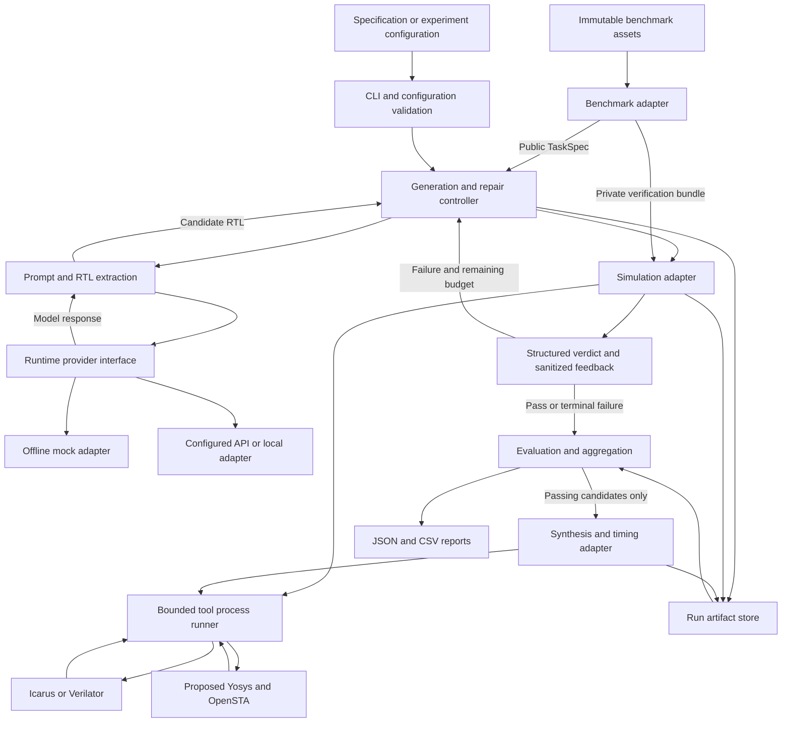

# Architecture

Planning baseline: November 8, 2026. This describes the intended modular Python system; no application modules existed at the planning baseline. Core boundaries are adopted in [DECISIONS.md](DECISIONS.md); concrete tools and defaults remain proposals where marked.

Current status (M1 closeout, November 8, 2026): `cli.py`, `models.py`, `storage.py`, `rtl.py` (admission screen only), `tools/{process,icarus,simulation}.py` and `benchmarks/local_fixtures.py` implement the offline M1 harness. Codex technically approved it in [reviews/M1_REVIEW_R3.md](reviews/M1_REVIEW_R3.md) (APPROVED WITH NON-BLOCKING ISSUES) for the trusted-fixture scope. Its deviations from section 3 are recorded in DECISIONS section 6 (M1-D6); those entries remain **proposed** until the team confirms them. No provider, repair, benchmark or synthesis component exists yet.

## 1. System flow



The controller decides what happens next. Adapters execute bounded operations and return structured data. The runtime model never controls shell commands, benchmark assets, or the pass/fail oracle.

## 2. Components and ownership boundaries

| Component / future path | Owns | Must not own |
| --- | --- | --- |
| `cli.py`, `config.py` | Input validation, selected adapters, explicit budgets, exit summary. | Repair policy, provider SDK calls, parsing tool logs. |
| `models.py` | Versioned provider-neutral records and outcome enums. | Tool invocation, SDK objects, implicit global configuration. |
| `controller.py` | Candidate lineage, stop conditions, one-shot/repair state machine. | Simulator-specific flags, benchmark file parsing, direct SDK calls. |
| `prompts.py`, `rtl.py` | Versioned generation/repair templates, bounded feedback, deterministic extraction and interface validation. | Changing testbenches, silently inventing missing interfaces. |
| `providers/` | Request/response normalization, capabilities, bounded transport retries, mock/API/local adapters. | Testbench access, compiler execution, deciding functional correctness. |
| `tools/process.py` | Argument-list subprocess execution, working directory, controlled environment, timeouts, process-tree cleanup, log limits. | Model-generated commands or simulator verdict interpretation. |
| `tools/simulation.py`, `tools/icarus.py` | Simulation contract, backend commands, compile/run outcome normalization. | Prompting and repair budgets. |
| `benchmarks/` | Task loading, fixed verification bundles, benchmark-specific verdict rules and provenance. | Provider selection or rewriting scoring assets. |
| `evaluation/` | Experiment scheduling, independent sampling, lineage-aware aggregation, pass@k, exports. | Treating dependent repairs as independent samples. |
| `synthesis/` | Passing-candidate mapping, reference comparison, area and timing reports. | Declaring functional pass or inventing missing constraints. |
| `storage.py` | Atomic artifact writes, IDs, hashes, schema version, replay metadata. | A database service or hidden selection of the best candidate. |

Use a simple synchronous controller first. No agent framework, web server, queue, distributed scheduler, or database is needed. Start with standard-library dataclasses, typing/Protocols, argparse, JSON, pathlib, and subprocess; add small dependencies only for demonstrated needs.

## 3. Contract baseline

These are semantic contracts, not final Python signatures. Freeze their first implementation in M1/M2; record incompatible changes and increment artifact schema versions.

| Record | Required information |
| --- | --- |
| `TaskSpec` | Task ID, public description, required top/ports/parameters, language mode, clock/reset semantics, public constraints, benchmark/revision identity. No reference RTL or private verification source. |
| `VerificationBundle` | Trusted asset paths/hashes, checker policy, top module, required support files, approved tool configuration. Kept out of provider-visible records. |
| `RunConfig` | Provider/model identifier, supported sampling settings, sample count `n`, `k` values, max repairs `r`, per-call/tool/run deadlines, retries, token/request ceilings, feedback policy, artifact root, seeds where supported. |
| `GenerationRequest` | Prompt text/version, requested output limits, optional supported seed/settings, request ID. No arbitrary executable tools. |
| `GenerationResponse` | Raw text, provider/model as returned, finish reason, usage if available, latency, provider request ID, structured service error when applicable. Secrets excluded. |
| `Candidate` | Task/sample/trajectory/attempt IDs, parent candidate ID, extracted RTL path/hash, raw response reference, extraction/interface outcome. Attempt `0` is initial generation. |
| `ProcessResult` | Argument vector, cwd, tool version, exit code/signal, duration, timeout flag, stdout/stderr paths, truncation flags. |
| `VerificationResult` | Candidate ID, compile and simulation status, functional verdict, failure category, diagnostic references, trusted asset hashes, approved repair feedback. |
| `TrajectoryResult` | Initial candidate and ordered repairs, terminal reason, final candidate/verdict, attempts, total requests/tokens/time, budget usage. |
| `SynthesisResult` | Candidate/reference IDs, synthesis status, mapped area/unit, delay/slack/unit, library/corner hash, constraints, timing coverage, tool/script versions, raw report references. Missing metrics are null with reasons. |

Separate stage status (`not_run`, `ok`, `failed`, `timeout`, `tool_error`) from functional verdict (`pass`, `fail`, `unknown`). Categories distinguish extraction/interface errors, compile errors, test mismatches, simulated design timeouts, missing tools, provider failures, and infrastructure failures. A timeout needs stage/context; it is not automatically a functional mismatch. Keep raw evidence even when classification is uncertain.

Provider contract: `generate(request) -> response` plus capability metadata. Select providers via validated configuration and a small explicit registry. Adapters reject unsupported settings rather than silently discarding them. Import optional SDKs only inside the chosen adapter; mock/replay operation must not require SDKs, credentials, network, or GPUs. API/local adapters may share this contract, but a local model is not assumed feasible on the team's machines.

Simulation contract: `verify(candidate, verification_bundle, limits) -> verification_result`. A backend must compile **and** execute a compatible checker. Verilator lint alone cannot satisfy this contract. The benchmark adapter supplies the trusted verdict policy; Icarus/Verilator details remain behind the simulation boundary.

## 4. Controller behavior

1. Validate task/interface, verification bundle, provider capabilities, tool availability, and all budgets. Create a unique run directory and immutable configuration snapshot.
2. Build a generation request from public task material. Save response and extraction evidence. Only deterministic wrapping explicitly required by a pinned benchmark is permitted and must be recorded.
3. Validate candidate shape/interface, then compile and simulate using the trusted bundle. Store the result before the next action.
4. On a pass, stop that trajectory. On repairable extraction, compile, or functional failure, construct feedback from the specification, current candidate, and approved diagnostics; generate a new complete RTL candidate with a parent link.
5. Stop at `r` repairs, total deadline, request/token ceiling, cancellation, or unrecoverable error. Stop after repeated identical candidate hashes under a declared stagnation policy. Preserve terminal reason and unsuccessful attempts.
6. Provider transport retries are bounded and logged separately from RTL repair attempts; they consume request/time budgets. Do not ask the model to repair a missing tool, authentication failure, or broken checker.

One-shot uses the same path with `r=0`. Independent samples have distinct sample IDs and no shared repair history. Evaluation can replay verification of stored candidates without contacting any model. Identical initial candidates can share saved verification evidence only when candidate, checker, toolchain, and configuration hashes match.

## 5. Execution and data boundaries

- Use explicit executable paths/argument lists with `shell=False`. Validate path containment and fixed filenames; a model cannot choose output paths, flags, includes, or top-level execution commands.
- Run each attempt in its own writable directory with bounded stdout/stderr, wall time, and process-tree cleanup. Enforce total run and artifact budgets as well as per-process limits.
- Child processes receive a minimal environment without provider keys. Keep trusted verification sources separate from candidate output; verify hashes before and after runs. Do not copy private source into prompts through diagnostics.
- A temporary directory and timeout are not an OS security sandbox. M1 executes only team-authored fixtures. Before the **first execution of model-generated RTL**, whichever milestone that happens in, select and validate an isolation policy that restricts filesystem access, network, and resources, and record the platform tradeoff in DECISIONS. Until then, `verify()` refuses `CandidateOrigin.MODEL_GENERATED` (DECISIONS M1-D5). Host isolation is separate from same-simulator checker interference, which the RTL admission screen addresses (M1-D4). Do not infer Docker availability or install infrastructure without need.
- Treat tool output and benchmark/model text as untrusted data. A string resembling an instruction or pass banner is not authorization and cannot override trusted verdict rules.

## 6. Artifacts and reproducibility

Proposed future layout per run:

```text
runs/<run_id>/
  manifest.json                       # schema, resolved config, versions, revisions/hashes
  tasks/<task_id>/samples/<sample_id>/
    attempts/000/                     # initial candidate; 001+ are dependent repairs
      request.json                    # prompt and settings; no credentials
      response.json
      candidate.v
      verification.json
      compile.stdout.log
      compile.stderr.log
      simulation.stdout.log
      simulation.stderr.log
    trajectory.json
  synthesis/<candidate_id>/           # selected passing candidates and reference reports
  results.json
  summary.csv
```

Keep raw and extracted responses distinct. Use unique IDs, atomic writes, and collision refusal; never overwrite earlier attempts. Every report row links to run/task/sample/attempt and underlying artifacts. A run manifest captures code revision when available (otherwise source hashes), dirty-workspace state, Python/OS/tool versions, benchmark revision and hashes, prompt versions, provider/model settings, budgets, and selection/exclusion policies. Resuming must validate matching inputs and cannot silently mix configurations. Add `runs/`, credentials, caches, and local environments to a future `.gitignore`; retain compact synthetic regression fixtures separately.

## 7. Proposed repository layout

Only the root instruction files and `docs/` exist at this planning stage. Create the other paths as their milestone needs them; `src/` is a Python source layout, not a second project root.

```text
Capstone/
  AGENTS.md
  CLAUDE.md
  docs/{PROJECT_SPEC,ARCHITECTURE,ROADMAP,TEAM_ROLES,DECISIONS}.md
  pyproject.toml                       # future: package metadata and tool settings
  README.md                           # future: verified setup and usage
  .gitignore                          # future
  src/verilog_copilot/
    {cli,config,models,controller,prompts,rtl,storage}.py
    providers/{base,mock,...}.py
    tools/{process,simulation,icarus,...}.py
    benchmarks/{base,...}.py
    evaluation/{runner,metrics,report}.py
    synthesis/{base,...}.py
  tests/
    unit/
    integration/
    fixtures/                         # team-authored RTL and trusted miniature checkers
  configs/                            # future: public example experiment configs
  benchmarks/                         # future: pinned external assets + provenance, immutable
  runs/                               # future: generated local artifacts
```

## 8. Technology proposals and evidence

Prefer Icarus first because it is already present; prove compatibility on the chosen benchmark revision before fixing the research environment. Add Verilator only if compatibility or cross-checking justifies it.

Propose [Yosys](https://github.com/YosysHQ/yosys) for synthesis and [OpenSTA](https://github.com/parallaxsw/OpenSTA) for static timing. OpenSTA consumes a gate-level netlist, Liberty library, and SDC constraints. Library choice, licensing/access, version pins, timing constraints, and reproducible local setup remain unresolved. These tools do not make FPGA deployment a requirement.
